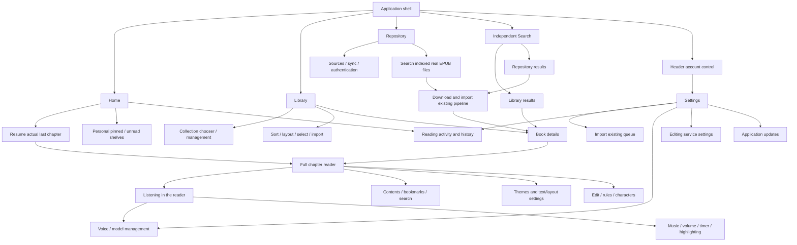

# Truyện+ — Apple Books product structure

Reference: 230 supplied Apple Books screenshots; Apple iOS 27 Books guides:
- https://support.apple.com/en-ie/guide/iphone/iphc1af7c57/27/ios/27
- https://support.apple.com/guide/iphone/listen-to-audiobooks-iphac1971248/27/ios/27

The screenshots define visual layout. The guides establish collection, reader and
playback behavior. Android keeps its platform Back, IME, file picker, accessibility
and installed TTS providers. No store, purchases, fabricated recommendations,
Apple account or unsupported service is added.

## Audit before implementation

| Priority | Existing evidence | Problem | Replacement |
|---|---|---|---|
| P1 | ReaderShellRoute searchOpen changes Library rendering | Search impersonates Library; Back and selected tab disagree | Independent search state with explicit Library / Repository scope and return destination |
| P1 | ReaderAppScope primary Settings, shelf external route | Major content repository hidden; system utilities occupy primary navigation | Home / Library / Repository, separate Search; Settings from header account control |
| P1 | Shell root content disposed on tab switch | Scroll/filter context can disappear; query resets unrelated to Back | Saveable state per primary destination; predictable Back contract |
| P1 | PageHeader + home-shelf + home-progress + import footer | Home reads as a tools dashboard; resume lacks visual emphasis | Continue hero, real personal shelves, reading activity; utilities in account/library menu |
| P1 | ReaderLibraryScreen permanent search + collections + counters + view/sort controls | Too much chrome before first cover, especially at large font sizes | Cover-first library; collections and More in the title row; dedicated search destination |
| P1 | Shell settings/progress booleans | Secondary screens replace top-level content without common header/back model | Settings as secondary account sheet with its own dismiss/back; progress retains actual stats/history |
| P2 | Shelf header back + manage + add + persistent search | Repository is a detached tool rather than primary content destination | Root repository, source selection, unified search field, quiet real results and explicit download states |
| P2 | Scrolling glass cards everywhere | Too many borders, duplicated rounded containers, weak hierarchy | Quiet reading surfaces and separators; frosted material reserved for floating chrome/panels |
| P2 | Book detail fixed neutral cover + flat summary | Primary book action and editorial hierarchy weak | Cover hero, readable centered title/author, primary Read and secondary Listen, About/Contents sections |
| P2 | Reader top long chapter capsule, Aa duplicated top/bottom | Large persistent chrome competes with text | Quiet centered identity, separate close/actions; lower reading toolbar owns common controls |
| P2 | Per-file constants and hard-coded spacing/font sizes | Inconsistent density and typography | Shared Books tokens, page header, section heading, search field, grouped rows |
| P2 | Library long press only for selection | Batch operations undiscoverable | Visible organization/selection action; retain long press and all batch operations |
| P2 | Search and scope switches use different chrome | Repeated setup and unclear source | Shared field + scope control; actual recent queries and actionable empty states |
| P2 | Mixed list/grid at large text | Cover sizes can hide subsequent rows | Adaptive cover grid; readable list when font/width demands it; minimum 48dp actions |

Legacy Discovery files remain unreachable. No active feature is removed by this
redesign. TTS engine/model management, background music, timer, chapter editor,
characters/rules, import/export, metadata refresh, pin/categories/read state,
Drive authentication/indexing/download and application updates retain handlers.

## Information architecture / screen hierarchy

## Navigation contract

- Three stable content tabs and one independent Search action. Search remembers
  its origin and scope; Back returns to that origin, not forcibly to Home.
- Settings is a secondary account surface, never a substitute for a content tab.
  Back closes progress, then account settings, then book details, then Search, then returns Home.
- Selecting a primary tab ends search and batch selection; content scroll and
  source filters are saved per destination. Repeated tab taps do not reset scroll.
- Book details stays inside the originating content/search context with its dock visible. Only the reader/listening canvas opens full screen; returning preserves details and the originating tab/query. Each book owns a separate detail ViewModel store. Legacy initialization runs after composition to prevent snapshot conflicts; closed details release their resources.
- Mini playback opens the existing full-chapter reader and retains the actual
  playback position. It never creates another competing audio session.
- One reader panel at a time; retain manual-scroll suspension and Return to speech.
- While listening, touching a paragraph exposes Listen from here; this selects its
  beginning through the existing reader-to-TTS mapping. It does not promise a seek
  to an individual word. A first touch in immersive mode reveals controls without
  seeking accidentally. Android QA verifies the real controller index changes.

## Visual / interaction system

- Page title: Source Serif 4 Display Bold 34sp/39sp. Section heading: 24sp/29sp. A single 302 KB OFL font replaces the generic system serif for editorial headings; controls and sheet navigation titles stay sans.
  UI body uses the system sans font, 16sp; secondary metadata 13sp. Respect system
  font scale; never shrink type to force fit.
- Spacing scale 4 / 8 / 12 / 16 / 20 / 24 / 32; page gutters 20dp phone, 32dp reference/wide.
  Reading content remains independently controlled by user paper/font preferences.
- Covers use the measured reference 0.64 width/height ratio; grids show progress and overflow below the artwork. Full title/author remain in list rows, details and accessibility semantics.
  No invented cover or source metadata before EPUB import.
- Quiet grouped surfaces, subtle dividers, no decorative full-screen glass layer.
  Existing tested frosted material remains on dock, floating reader controls and
  transient sheets. Light/dark use semantic colors and independent reader paper.
- 48dp minimum controls (Android accessibility), descriptive labels, selected states.
  Root transitions use brief opacity changes; no animation of thousands of books.
  Vertical content scroll stays lazy; selection animation stays in the dock.
- Phone portrait: one content pane; large text uses list rows. Tablet/split window:
  bounded content width and adaptive grid; book details may use supporting contents.
- Loading/error/empty remain distinct. Repository incomplete indexing never claims
  zero results conclusively; downloads retain cancel/retry/open behavior.

## Verification / acceptance

- Navigation unit tests: Search and account return path, legacy Settings entry,
  primary tab selection, Back ordering, stable primary destinations.
- UI tests: clear Home / Library / Repository hierarchy, account action, independent
  search, collection/sort/layout/selection/import callbacks, book actions/contents,
  light/dark and narrow/large-font touch bounds.
- Android QA: native screen transitions, collection/selection, real repository
  flow where available, full reader/listen controls and settings exclusivity.
- Existing reader/TTS/editing/Drive tests remain regression requirements. No claim
  of universal device performance or physical TalkBack validation without evidence.

## Visual source-of-truth mapping (stronger fidelity requirement)

| Screenshot IDs | App mapping | Layout commitments |
|---|---|---|
| 3–13, 18–19 | Home / Continue / activity | Large serif title + top-right account, compact horizontal continue card, editorial shelves, section separation; no tools dashboard |
| 31–34, 46–62 | Library / organization | Cover-first two-column phone grid, collections and More beside the page title; per-book overflow and one-tap Done during selection; collection chooser is a sheet |
| 35–45 | Collection flow | Centered sheet title, dismiss and manage, grouped selection rows; real custom collections, no invented system data |
| 74–83, 138–145 | Global search / recent queries | Own destination and title, quiet search field, vertical recent rows; Library / Repository scope is the app-specific extension |
| 92–99, 116–118 | Repository results / details | Quiet cover + text result rows, one download/open action; cover-led detail hero and editorial About section |
| 132–163, 180–183 | Chapter reader / menus | Minimal identity/close, text-first canvas, lower menu/control cluster, floating settings without full-width backing strip |
| 146–179 | Themes / customization | Aa paper tiles and compact settings hierarchy; keep all existing text/layout/brightness features |
| 184–229 | Audio, account and supporting flows | Reference sheet, action and playback structure where corresponding app functions exist; Android TTS stays inside full chapter reader |

Use the supplied PNGs as visual authority. Do not copy Apple store content or
invent reviews/prices/ratings. Editorial typography uses the OFL Source Serif 4 Display Bold;
SF Pro/New York binaries are not distributed. Ratios and spacing are measured at
393pt reference width and adapted only for Android insets, minimum 48dp targets,
large text and tablet/split-screen constraints. Real-book cover colors may drive
hero colors through the existing image pipeline; missing covers remain neutral.

## Measured correction after visual QA feedback

The initial QA contact sheet was rejected as insufficiently faithful. It is not a release candidate.
Screenshots 7, 32, 74 and 116 were reopened at 1179×2556 (393pt @3x).
The second implementation replaces these incorrect defaults:

| Element | Measured target at 393pt | Implementation |
|---|---:|---|
| Home continue card | ~244×80pt | Fixed compact width; larger text may expand it |
| Continue card top | 169pt including 24dp Android status inset | 145dp inside the safe drawing area |
| Home opening section end | 281pt including status inset | 257dp, subtle lower background tone |
| Library first cover top | ~136pt including status inset | 112dp inside the safe drawing area |
| Two-column cover | ~156.5×244.5pt | 32dp gutters, 16dp gap, ratio0.64 |
| Navigation capsule/search | 64pt high | 56dp tab hit area + 4dp inner padding |
| Bottom Search | 48pt circle, 28pt outer gutter | Search scope menu extends the magnifier; no extra segmented toolbar |

Section chevrons follow the heading text instead of sitting at the far edge.
Cover grids avoid duplicating a title already on the cover; full title/author remain in
accessibility semantics, list layout and book details. Reading activity maps the existing
chapter progress to the reference circular presentation; no daily goal or statistic is invented.
Three existing EPUB metadata/covers are read only into the isolated QA application for
realistic screenshots; those fixtures are not committed, bundled or added to the user's library.

Font source and license: [Adobe Source Serif](https://github.com/adobe-fonts/source-serif),
release commit `80d3f8894c09c937bebfa9011247d2e1c79fd6f4`, `TTF/SourceSerif4Display-Bold.ttf`.
The original OFL text ships in compose resources under files/licenses/source-serif.txt.
No Apple SF Pro/New York binary is copied.

## Verified implementation — 15 October 2026

- All 227 Truyện+ desktop UI/behavior tests pass, including measured reference
  geometry, heading ink weight, navigation, typography, colors, editing, Drive,
  playback, highlighting, timer and buffering regressions.
- Android phone QA passes the complete root navigation/search/detail/read/listen
  journey, collections and papers, font changes and panel exclusivity, independent
  paper/app themes, account/import in both themes, chapter playback navigation,
  voice management and Listen from here. The last action asserts the actual
  TTSController paragraph index, rather than only testing a callback.
- The complete phone journey passes at 200% system text; the first-paragraph and
  floating-header bounds check passes separately. The complete tablet journey
  passes at 1600×1066dp. Its contents pane now requests the next layout's scroll
  instead of recursively measuring during composition.
- Actual Android audio tests pass for Google system TTS, Piper and VieNeu Nano,
  including offline model installation, two Nano voices, cancellation and resume.
  Two consecutive paragraph transitions per engine measured 51/90ms (system),
  25/56ms (Piper), and 28/47ms (Nano). These measure Completed-to-Started events
  through real playback; they are not a long-session or physical A9 benchmark.

The offline continuity correction reuses the one-sentence audio buffer. Internal
sentences take priority; while the final sentence plays, the first sentence of
the following paragraph is prepared. Natural completion retains that work.
Explicit pause, seek, voice replacement and release still cancel it. This avoids
discarding and regenerating audio at every natural paragraph transition without
pre-synthesizing whole chapters or adding a persistent model/audio cache.

Actual phone/tablet screenshots were inspected against the supplied references.
QA covers/metadata come from the user's existing EPUBs and stay in the isolated
QA package; production contains no test library, copied Apple content, or voice
models. No physical Samsung A9/Redmi, TalkBack session, battery benchmark or
claim of exact iOS rendering on Android is implied by these checks.
